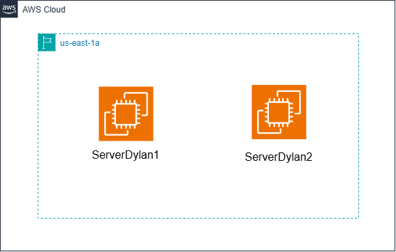

# Primeras Instancias con Terraform

En este proyecto se usa **_Terraform_** para crear dos instancias **EC2** (_ServerDylan1 y ServerDylan2_) en **_AWS_**.  
Ambas instancias seran del tipo **t3.micro**, usaran **Amazon Linux 2023** como sistema operativo y su region sera la **us-east-1a**.  
