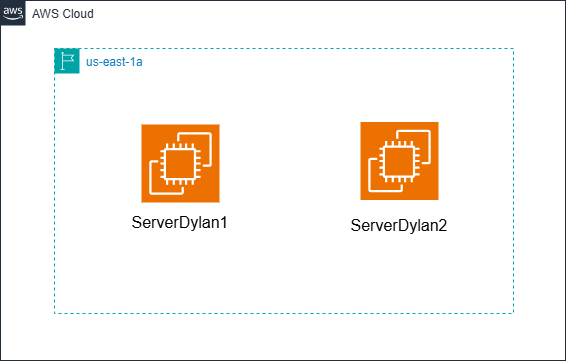

# Primeras Instancias con Terraform

En este proyecto se usa **_Terraform_** para crear dos instancias **EC2** (_ServerDylan1 y ServerDylan2_) en **_AWS_**.  
Ambas instancias seran del tipo **t3.micro**, usaran **Amazon Linux 2023** como sistema operativo y su region sera la **us-east-1a**.  

  

## Notas sobre el contenido de main.tf  

El script indica primero el proveedor y la region:  
```
# region indica la region donde trabajaran las instancias.

provider "aws" {
  region = "us-east-1"
}
```  

El siguiente bloque de codigo indica el sistema operativo que usaran las instancias, usaran la version mas reciente de Amazon Linux 2023:  
```
# El valor de most_recent esta en true, eso significa que aplicara la version mas reciente del sistema operativo.

data "aws_ami" "amazon_linux_23" {
  most_recent = true
  owners      = ["amazon"]

  filter {
    name   = "name"
    values = ["al2023-ami-2023.*-x86_64"]
  }

  filter {
    name   = "virtualization-type"
    values = ["hvm"]
  }
}
```  

Por ultimo se crean las instancias:  
```
# count indica el numero de instancias que se crearan en este caso dos.
# En ami se indica el sistema operativo.
# instance_type indicamos el tipo de instancia.

resource "aws_instance" "web" {
  count = 2

  ami           = data.aws_ami.amazon_linux_23.id
  instance_type = "t3.micro"

  tags = {
    Name = "ServerDylan${count.index + 1}"
  }
}
```  
### Comandos de Terraform  
Para usar el script necesitaras los siguientes comandos.  

Configura tu directorio.  
```
terraform init
```  
Verifica el script y muestra los cambios que realizara.  
```
terraform plan
```  
Ejecuta el script.  
```
terraform apply
```  
Elimina lo que ha creado el script.  
```
terraform destroy
```