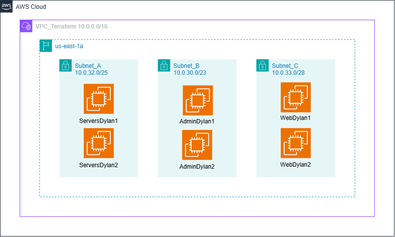
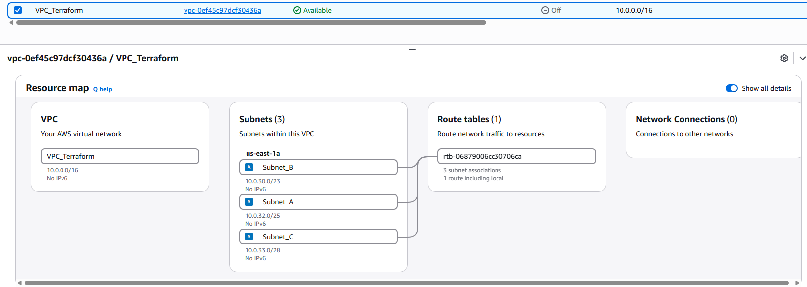
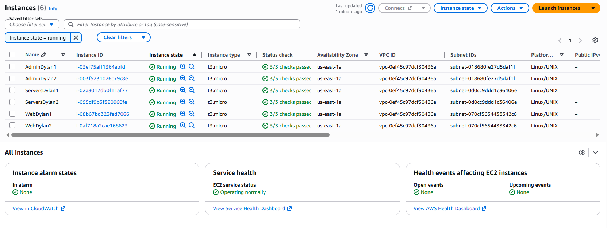

# VPC y Subredes con Terraform  
  
En **_AWS_** crearemos una **VPC** con **3 subredes**:  
- VPC_Terraform: 10.0.0.0/16
   - Subnet_A: 10.0.32.0/25
   - Subnet_B: 10.0.30.0/23
   - Subnet_C: 10.0.33.0/28  

  
Cada subred tendra 2 instancias **EC2** assignadas:  
- Subnet_A
   - ServersDylan1
   - ServersDylan2
- Subnet_B
   - AdminDylan1
   - AdminDylan2
- Subnet_C
   - WebDylan1
   - WebDylan2  

En total son 6 instancias EC2 de tipo t3.micro
  
## Sobre el contenido de main.tf  
El script creara todo lo mencionado anteriormente siguiendo un orden, primero creara el **VPC**, luego creara las **subredes** y por ultimo las **instancias**.  

Las subredes necesitan de una VPC para ser creadas correctamente es por eso que la VPC es lo primero que se debe crear:  
```
# Se crea la VPC con nombre VPC_Terraform
resource "aws_vpc" "vpc_terraform" {
  cidr_block           = "10.0.0.0/16"
  enable_dns_hostnames = true
  enable_dns_support   = true

  tags = {
    Name = "VPC_Terraform"
  }
}
```  

Luego de crear la VPC ahora si creamos la subred:
```
# Se crea la Subnet_A asignada a VPC_Terraform.
# vpc_id indica la VPC a la que esta subred esta asignada.
resource "aws_subnet" "subnet_a" {
  vpc_id            = aws_vpc.vpc_terraform.id
  cidr_block        = "10.0.32.0/25"
  availability_zone = "us-east-1a"

  tags = {
    Name = "Subnet_A"
  }
}
```  

Es mejor dejar las instancias al final, asi cuando se crean ya estaran asignadas a su subred:  
```
# Se crea una instancia asignada a la subnet_a
# subnet_id indica la subnet que la instancia tiene asignada.
resource "aws_instance" "servers_dylan" {
  count         = 2
  ami           = data.aws_ami.amazon_linux.id
  instance_type = "t3.micro"
  subnet_id     = aws_subnet.subnet_a.id

  tags = {
    Name = "ServersDylan${count.index + 1}"
  }
}
```  

### Comandos de Terraform  
Para usar el script necesitaras los siguientes comandos.  

Configura tu directorio.  
```
terraform init
```  
Verifica tu script y te muestra los cambios que realizara.  
```
terraform plan
```  
Ejecuta el script.  
```
terraform apply
```  
Elimina lo que ha creado el script.  
```
terraform destroy
```