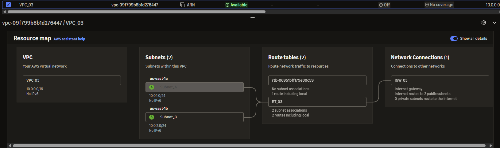
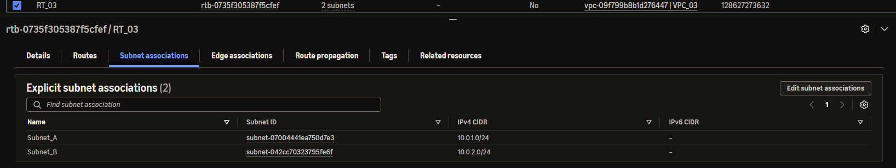
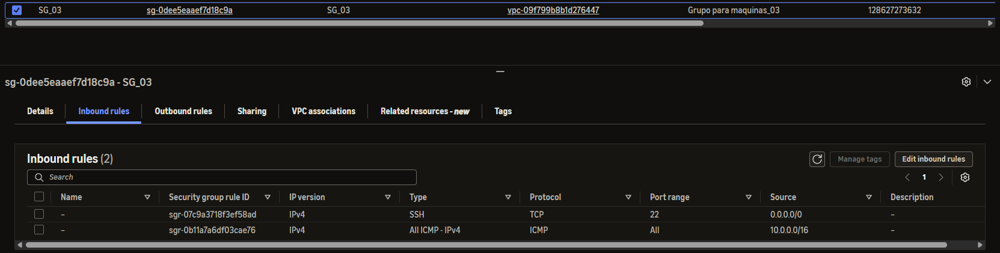
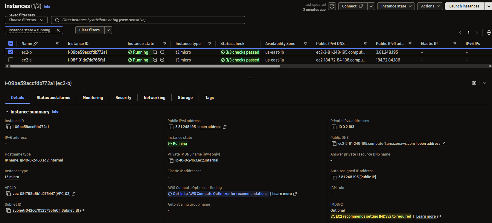

# Descripcion de la practica  
El objetivo de esta practica es realizar un script con terraform que cree una infraestructura en **AWS**. El proveedor trabajara en la region **us-east-1**.  

Se creara una **VPC** con 2 **Subredes**:  
- VPC_03: 10.0.0.0/16
   - Subnet_A: 10.0.1.0/24
     - zona: us-east-1a
   - Subnet_B: 10.0.2.0/24
     - zona: us-east-1b  

Las dos subredes assignaran automaticamente una ip publica a las instancias al momento de desplegarlas.  
  

Ademas, se creara una **puerta de enlace** y una **tabla de enrutamiento** que tendran que *asociarse* a las **subredes**.  
  

Ahora se crea el **security group**, este grupo de seguridad permitira el acceso por ssh, permitira el transito ICMP unicamente a traves de la VPC y permite todo el transito de salida hacia cualquier direccion:  
  

Finalmente se crearan las **instancias**.  
  

## Contenido del script main.tf  
Esta parte del codigo indica el **proveedor** y la **region**:  
```
provider "aws" {
  region = "us-east-1"
}
```  
El script primero crea la **VPC** y las dos **subredes** como se mostraron en ejercicios anteriores.  
```
# VPC

resource "aws_vpc" "vpc_03" {
  cidr_block           = "10.0.0.0/16"
  enable_dns_hostnames = true
  enable_dns_support   = true

  tags = {
    Name = "VPC_03"
  }
}

# Subredes

resource "aws_subnet" "subnet_a" {
  vpc_id                  = aws_vpc.vpc_03.id
  cidr_block              = "10.0.1.0/24"
  availability_zone       = "us-east-1a"
  map_public_ip_on_launch = true

  tags = {
    Name = "Subnet_A"
  }
}

resource "aws_subnet" "subnet_b" {
  vpc_id                  = aws_vpc.vpc_03.id
  cidr_block              = "10.0.2.0/24"
  availability_zone       = "us-east-1b"
  map_public_ip_on_launch = true

  tags = {
    Name = "Subnet_B"
  }
}
```  

Ahora crea la **puerta de enlace**:  
```
# Internet Gateway

resource "aws_internet_gateway" "igw_03" {
  vpc_id = aws_vpc.vpc_03.id

  tags = {
    Name = "IGW_03"
  }
}
```  
Para poder dirigir el trafico de red provenientes de las subredes o de la VPC al gateway que acaba de crear, el script crea un **_route table_**:  
```
# Route Table

resource "aws_route_table" "rt_03" {
  vpc_id = aws_vpc.vpc_03.id

  route {
    cidr_block = "0.0.0.0/0"
    gateway_id = aws_internet_gateway.igw_03.id
  }

  tags = {
    Name = "RT_03"
  }
}
```  
Para que el enrutamiento funcione debemos crear **associaciones**, estas associaciones sirven para vincular un recurso de red ya sea una subred o la VPC a la **tabla de enrutamiento**:  
```
# Associaciones de Route Table a las Subredes

resource "aws_route_table_association" "rt_03_a" {
  subnet_id      = aws_subnet.subnet_a.id
  route_table_id = aws_route_table.rt_03.id
}

resource "aws_route_table_association" "rt_03_b" {
  subnet_id      = aws_subnet.subnet_b.id
  route_table_id = aws_route_table.rt_03.id
}
```  
Ahora el script crea el security group:  
```
# Security Group

resource "aws_security_group" "sg_03" {
  name        = "SG_03"
  description = "Grupo para maquinas_03"
  vpc_id      = aws_vpc.vpc_03.id

  ingress {
    from_port   = 22
    to_port     = 22
    protocol    = "tcp"
    cidr_blocks = ["0.0.0.0/0"]
  }

  ingress {
    from_port   = -1
    to_port     = -1
    protocol    = "icmp"
    cidr_blocks = [aws_vpc.vpc_03.cidr_block]
  }

  egress {
    from_port   = 0
    to_port     = 0
    protocol    = "-1"
    cidr_blocks = ["0.0.0.0/0"] 
  }

  tags = {
    Name = "SG_03"
  }
}
```  
Por ultimo se crean las **instancias**:  
```
# Instancias

data "aws_ami" "amazon_linux" {
  most_recent = true
  owners      = ["amazon"]

  filter {
    name   = "name"
    values = ["amzn2-ami-hvm-*-x86_64-gp2"]
  }
}

resource "aws_instance" "ec2-a" {
  ami                    = data.aws_ami.amazon_linux.id
  instance_type          = "t3.micro"
  subnet_id              = aws_subnet.subnet_a.id
  key_name               = "vockey"
  vpc_security_group_ids = [aws_security_group.sg_03.id]

  tags = {
    Name = "ec2-a"
  }
}

resource "aws_instance" "ec2-b" {
  ami                    = data.aws_ami.amazon_linux.id
  instance_type          = "t3.micro"
  subnet_id              = aws_subnet.subnet_b.id
  key_name               = "vockey"
  vpc_security_group_ids = [aws_security_group.sg_03.id]

  tags = {
    Name = "ec2-b"
  }
}
```  

### Comandos de Terraform  
Para usar el script necesitaras los siguientes comandos.  

Configura tu directorio.  
```
terraform init
```  
Verifica el script y muestra los cambios que realizara.  
```
terraform plan
```  
Ejecuta el script.  
```
terraform apply
```  
Elimina lo que ha creado el script.  
```
terraform destroy
```